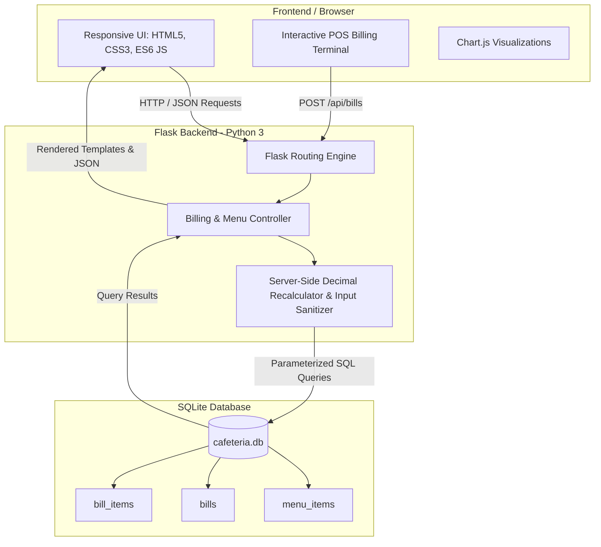
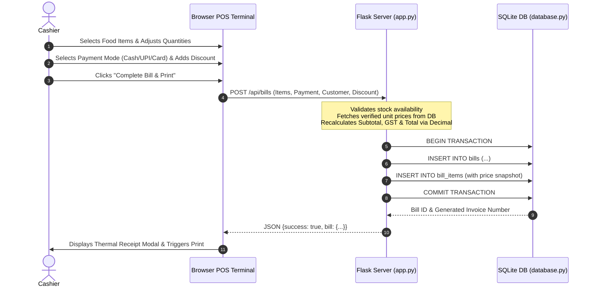
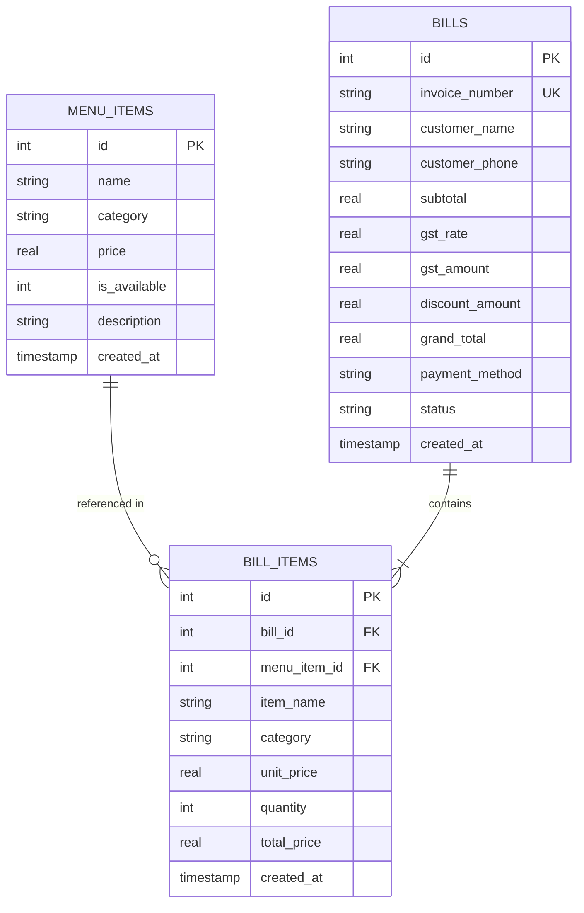

# 📄 Project Report & Technical Documentation
# Cafeteria Billing System

---

## 📌 Project Overview
- **Project Title:** Cafeteria Billing System
- **Domain:** Web Application / Point of Sale (POS) / Financial Information Systems
- **Target Audience:** College Cafeterias, University Canteens, Small Food Businesses
- **Primary Access URL:** `http://127.0.0.1:8000`
- **Technology Stack:**
  - **Backend:** Python 3 (Flask Framework)
  - **Database:** SQLite 3 (ACID compliant with Foreign Key Constraints)
  - **Frontend:** HTML5, CSS3 (Custom Responsive Design System), Modern JavaScript (ES6+)
  - **Data Visualizations:** Chart.js 4.4
  - **Typography & Icons:** FontAwesome 6, Google Fonts (*Outfit*, *Inter*, *JetBrains Mono*)

---

## 1. Abstract / Executive Summary

Traditional college cafeterias and food courts often rely on handwritten slips or disjointed spreadsheets to manage daily counter billing. This manual workflow leads to long student queues during peak lunch hours, frequent calculation mistakes, unverified tax computations, lost transaction records, and an inability to track daily revenue or popular food items.

**Campus Cafe** is an end-to-end, lightweight, and self-hosted Cafeteria Billing & Point-of-Sale (POS) web application designed to solve these operational bottlenecks. Built using Python Flask and SQLite, it offers high-speed order punching, instant decimal-accurate calculations, configurable GST and discount logic, multi-payment tracking (Cash, UPI, Card), authentic 80mm thermal receipt printing, full menu CRUD with real-time stock toggling, and interactive sales reporting with Chart.js analytics.

---

## 2. Problem Statement & Objectives

### 2.1 Problems in Traditional Cafeteria Management
1. **Slow Order Processing:** Cashiers spending excessive time calculating subtotals and writing manual tokens.
2. **Calculation Errors:** Rounding discrepancies, incorrect GST additions, and inaccurate discount applications.
3. **Loss of Historical Audit Trail:** When food item prices change in a canteen, old paper records become inconsistent.
4. **Lack of Business Intelligence:** Cafeteria managers cannot easily see which food items are running out of stock or which items generate the highest revenue.

### 2.2 Project Objectives
- Build an ultra-fast, intuitive POS interface accessible locally via `http://127.0.0.1:8000`.
- Enforce **strict decimal precision** using Python's `Decimal` module on the backend to eliminate client-side tampering.
- Preserve **immutable historical snapshots** of item names and prices at the time of each purchase.
- Provide a clean, print-friendly **80mm thermal receipt slip** with standard tax breakdowns (CGST + SGST), QR code mockups, and barcodes.
- Provide automated **Daily, Weekly, and Monthly sales analytics** with exportable CSV data.

---

## 3. System Architecture & Data Flow

### 3.1 Three-Tier Architecture
The system adopts a modular 3-tier architecture separating presentation, business logic, and database storage:



### 3.2 Data Flow Diagram (DFD Level 1 - Order Processing)



---

## 4. Database Design & Schema Specification

The database is built on **SQLite 3** with foreign key enforcement and transactional integrity.

### 4.1 Entity Relationship Diagram (ERD)



### 4.2 Table Definitions

#### Table 1: `menu_items`
Stores the active cafeteria food and beverage catalog.
| Column | Type | Constraints | Description |
|---|---|---|---|
| `id` | INTEGER | PRIMARY KEY AUTOINCREMENT | Unique item identifier |
| `name` | TEXT | NOT NULL | Item title (e.g. *Masala Dosa*) |
| `category` | TEXT | NOT NULL | *Snacks*, *Meals*, *Beverages*, *Desserts* |
| `price` | REAL | NOT NULL | Current selling price in Indian Rupees (₹) |
| `is_available` | INTEGER | NOT NULL DEFAULT 1 | Stock flag (1 = In Stock, 0 = Out of Stock) |
| `description` | TEXT | DEFAULT '' | Brief description or serving note |
| `created_at` | TIMESTAMP | DEFAULT CURRENT_TIMESTAMP | Date & time added |

#### Table 2: `bills`
Stores summary records for every completed counter transaction.
| Column | Type | Constraints | Description |
|---|---|---|---|
| `id` | INTEGER | PRIMARY KEY AUTOINCREMENT | Internal primary key |
| `invoice_number`| TEXT | UNIQUE NOT NULL | Formatted invoice: `BILL-YYYYMMDD-XXXX` |
| `customer_name` | TEXT | DEFAULT 'Walk-in Customer' | Customer name (optional) |
| `customer_phone`| TEXT | DEFAULT '' | 10-digit mobile number (optional) |
| `subtotal` | REAL | NOT NULL | Pre-tax sum of all items |
| `gst_rate` | REAL | DEFAULT 5.0 | GST rate percentage (default 5.0%) |
| `gst_amount` | REAL | NOT NULL | Calculated GST amount |
| `discount_amount`| REAL | DEFAULT 0.0 | Applied discount in ₹ |
| `grand_total` | REAL | NOT NULL | Final payable amount in ₹ |
| `payment_method`| TEXT | NOT NULL | *Cash*, *UPI*, or *Card* |
| `status` | TEXT | DEFAULT 'Completed' | Transaction status |
| `created_at` | TIMESTAMP | DEFAULT CURRENT_TIMESTAMP | Timestamp of checkout |

#### Table 3: `bill_items`
Stores the line items of each bill. Crucially, it preserves an **immutable historical snapshot** (`item_name` and `unit_price`) so that if a menu item's price is updated later, past receipts remain 100% accurate.
| Column | Type | Constraints | Description |
|---|---|---|---|
| `id` | INTEGER | PRIMARY KEY AUTOINCREMENT | Primary key |
| `bill_id` | INTEGER | NOT NULL, FK -> bills(id) | References the parent bill (CASCADE DELETE) |
| `menu_item_id` | INTEGER | NULLABLE, FK -> menu_items(id) | Soft link to menu catalog |
| `item_name` | TEXT | NOT NULL | **Snapshot** of item name at time of sale |
| `category` | TEXT | NOT NULL | Category at time of sale |
| `unit_price` | REAL | NOT NULL | **Snapshot** of unit price at time of sale |
| `quantity` | INTEGER | NOT NULL | Quantity ordered (must be >= 1) |
| `total_price` | REAL | NOT NULL | `unit_price * quantity` |
| `created_at` | TIMESTAMP | DEFAULT CURRENT_TIMESTAMP | Creation timestamp |

---

## 5. Functional Modules Specification

### 5.1 Dashboard Module (`/dashboard`)
- **Key Performance Indicators**:
  - Today's Revenue (₹)
  - Today's Orders Count
  - Total Menu Items (and active in-stock count)
  - Lifetime Completed Transactions & Lifetime Revenue
- **Quick Action Launchpad**: High-priority shortcut cards to POS Billing, Menu Management, and Reports.
- **Recent Transactions Stream**: Interactive table showing recent orders with one-click receipt view and reprint buttons.

### 5.2 POS Billing Terminal (`/billing`)
- **Category Filter Tabs**: One-click switching between All, Snacks, Meals, Beverages, and Desserts.
- **Search-as-you-type**: Instant client-side DOM filtering without reloading the page.
- **Live Cart Operations**:
  - Add to cart with visual notification feedback.
  - Increment/decrement quantity with instant recalculation.
  - Quick discount preset chips (₹0, ₹10, ₹20, ₹50) and manual discount input.
  - Configurable GST selector (0%, 5%, 12%).
- **Payment Method Toggle**: Cash, UPI / QR, Card.
- **Automated Sequential Invoices**: Format `BILL-YYYYMMDD-0001`, `BILL-YYYYMMDD-0002`, etc.

### 5.3 Menu Management Module (`/menu`)
- **Add New Food Item**: Modal dialog with input validation (name, category, price >= 0, stock availability, description).
- **Edit Item**: Pre-populates existing record details for fast price revisions.
- **Delete Confirmation**: Guard modal prevents accidental deletion while leaving old invoice records intact.
- **Live Stock Switch**: AJAX-based toggle (`PATCH /api/menu/<id>/toggle`) allows cashiers to mark sold-out items in 1 click without refreshing the page.

### 5.4 Thermal Receipt Generator (`/receipt/<id>`)
- Formatted strictly to mimic an **80mm point-of-sale thermal slip**.
- Features cafe header branding, student center address, mock GSTIN, timestamp, customer name, and cashier counter number.
- Itemised table with quantity, unit rate, and total price.
- Detailed tax calculation showing **CGST (2.5%)** and **SGST (2.5%)**.
- UPI QR code mockup and barcode graphic simulation.
- Print stylesheet (`@media print`) that strips navigation, backgrounds, and buttons for clean black-and-white printing.

### 5.5 Sales Analytics & Reporting (`/reports`)
- **Timeframe Selector**: Today, Last 7 Days, Last 30 Days, All Time, or Custom Date Range.
- **Chart.js Visualizations**:
  - Revenue & Orders Trend (Dual-axis Line / Bar Chart)
  - Sales by Category Distribution (Doughnut Chart)
  - Payment Method Volume Share (Doughnut Chart)
- **Top 10 Popular Items Table**: Ranks food items by total volume sold and generated revenue.
- **CSV Export**: One-click CSV download for spreadsheets.

### 5.6 Order History Archive (`/history`)
- Historical database table featuring search by invoice number, customer name, date range filters, and payment method filter.
- Direct **Reprint Receipt** actions.

---

## 6. Implementation & Security Highlights

### 6.1 Server-Side Decimal Arithmetic
JavaScript floating-point arithmetic is prone to precision rounding errors. Campus Cafe implements server-side recalculation using Python's native `Decimal` module:
```python
unit_price = Decimal(str(menu_row["price"])).quantize(Decimal('0.01'), rounding=ROUND_HALF_UP)
item_total = (unit_price * Decimal(str(quantity))).quantize(Decimal('0.01'), rounding=ROUND_HALF_UP)
subtotal += item_total
...
gst_amt = (taxable_amt * gst_rate_dec / Decimal('100.0')).quantize(Decimal('0.01'), rounding=ROUND_HALF_UP)
grand_total = (taxable_amt + gst_amt).quantize(Decimal('0.01'), rounding=ROUND_HALF_UP)
```

### 6.2 SQL Injection Prevention
All SQL queries in `database.py` strictly utilize parameterized statements (`?` placeholders). No user inputs are concatenated directly into SQL queries.

### 6.3 Anti-Tampering Price Validation
Frontend prices sent in HTTP POST requests are ignored. The backend looks up the true active price of each item from the database, ensuring users cannot manipulate cart prices via browser developer tools.

### 6.4 Cache-Control Headers
To prevent browsers from serving stale cache or conflicting offline service workers, `app.py` attaches strict no-cache headers to all responses.

---

## 7. Verification & Test Results

An automated end-to-end test suite (`test_endpoints.py`) was developed and executed to validate system integrity:

| Test ID | Test Scenario | Input Data | Expected Result | Actual Result | Status |
|---|---|---|---|---|---|
| **TC-01** | Load Main Pages | `GET /dashboard, /billing, /menu, /history, /reports` | HTTP 200 OK for all views | HTTP 200 OK | **PASSED** |
| **TC-02** | Fetch Active Menu | `GET /api/menu` | Returns JSON with >= 20 items | 24 items returned | **PASSED** |
| **TC-03** | Create Bill Calculation | 2 x Cold Coffee (₹75 = ₹150), ₹10 Disc, 5% GST | Subtotal: ₹150, GST: ₹7.00, Total: ₹147.00 | Exact match | **PASSED** |
| **TC-04** | Sequential Invoice | Generate new bill | Invoice format: `BILL-YYYYMMDD-XXXX` | Formatted correctly | **PASSED** |
| **TC-05** | Receipt Generation | `GET /receipt/<bill_id>` | HTTP 200 with itemised tax slip | Rendered cleanly | **PASSED** |
| **TC-06** | Add Menu Item | `POST /api/menu` (Paneer Tikka Roll @ ₹125) | Item added with new ID | ID 26 created | **PASSED** |
| **TC-07** | Stock Toggle | `PATCH /api/menu/<id>/toggle` | Availability flips 1 -> 0 | Stock set to 0 | **PASSED** |
| **TC-08** | Delete Menu Item | `DELETE /api/menu/<id>` | Item removed from menu | Deleted successfully | **PASSED** |
| **TC-09** | Report Analytics API | `GET /api/reports/data?period=today` | Returns aggregated revenue & trends | Calculated from DB | **PASSED** |

---

## 8. Deployment & Execution Instructions (Windows)

### Step 1: Open PowerShell / Terminal
```powershell
cd "c:\Users\Asus\Sahil project"
```

### Step 2: Install Dependencies
```powershell
pip install -r requirements.txt
```

### Step 3: Run the Application
```powershell
python app.py
```

### Step 4: Access the System
Open your web browser and navigate directly to:
👉 **`http://127.0.0.1:8000`**

### Step 5: Run Automated Tests
```powershell
python test_endpoints.py
```

---

## 9. Conclusion & Future Enhancements

The **Campus Cafe POS & Billing System** delivers a robust, high-performance solution for college cafeterias and food businesses. It effectively automates order punching, eliminates calculation mistakes, ensures tax compliance, and equips managers with real-time sales visibility.

### Future Scope:
1. **Kitchen Display System (KDS)**: Real-time order screen in the kitchen for chefs to mark prepared meals.
2. **Student Card / RFID Integration**: Direct tap-to-pay via student university ID cards.
3. **SMS / WhatsApp Receipts**: Automated PDF invoice dispatch to customer mobile numbers.
